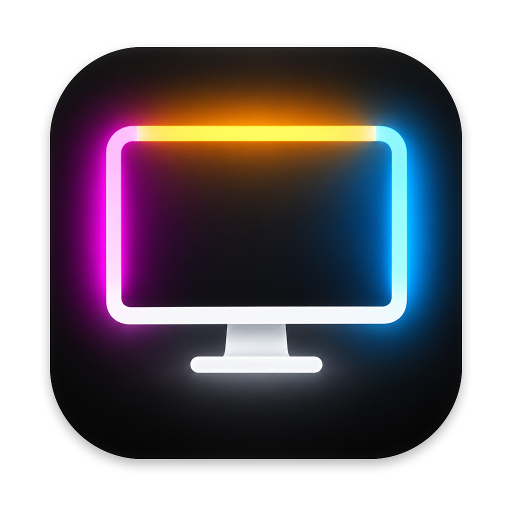
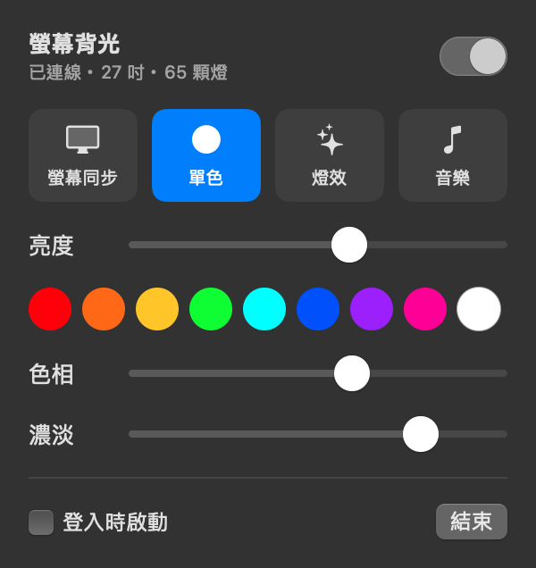
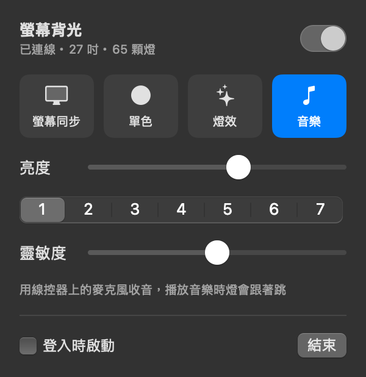

<p align="center">
  
</p>

<h1 align="center">MonitorGlow</h1>

<p align="center">
  A small, native macOS menu bar app for ROBOBLOQ SyncLight USB monitor light strips.
</p>

<p align="center">
  <b>English</b> · <a href="README.zh-TW.md">繁體中文</a>
</p>

<p align="center">
  
  
</p>

> **Unofficial.** MonitorGlow is an independent project. It is not affiliated with, endorsed by, or supported by ROBOBLOQ. "SyncLight" and "ROBOBLOQ" are used only to identify compatible hardware.

## Features

- **Screen sync** — matches the strip to the left, top and right edges of your main display. Adjustable response and vividness, and it ignores letterbox bars in videos.
- **Solid color** — presets plus hue and saturation sliders.
- **Built-in effects** — the strip's own 7 dynamic effects, with a speed slider.
- **Music** — the strip's own 7 sound-reactive modes, using the microphone in its inline controller.
- **Light on resources** — about 3% CPU and 27 MB of memory while syncing on a Mac mini M4 (one short measurement). Nothing is sent while the picture is still.
- **Offline** — the app contains no networking code. Screen frames are downscaled, averaged in memory, and never stored.

The interface is currently in Traditional Chinese only.

## Is this for my strip?

These strips are often sold unbranded or under a seller's own name, so the name on the box may not help. Yours is likely compatible if:

- the manual tells you to install **SyncLight** (神光同步) from a **quiklight.robobloq.com** or **quiklight.robobloq.cn** address, and
- it plugs in over USB and shows up with the IDs below.

The author's unit is labeled "Wonderful Life" in its manual. The USB manufacturer string is **ROBOBLOQ**.

## Compatibility

| | Status |
|---|---|
| USB `1a86:fe07`, model `000501`, 27", 65 LEDs, firmware 1.9.4 | Tested |
| Other strips with USB ID `1a86:fe07` | Should connect; untested |
| `1a86:fe0c` (serial variant), Bluetooth or dongle models | Not supported |

Check yours with **System Information → USB**: vendor ID `0x1a86`, product ID `0xfe07`, manufacturer ROBOBLOQ.

Requires macOS 14 or later. Developed and tested only on macOS 27 with Apple silicon.

## Installation

There are no pre-built downloads. Build from source; only the Xcode Command Line Tools with Swift 6 or later are needed.

```bash
xcode-select --install          # skip if already installed
git clone https://github.com/zx4032410/MonitorGlow.git
cd MonitorGlow
scripts/install.sh
```

`install.sh` builds the app, replaces any existing copy at `/Applications/螢幕背光.app`, and opens it. "螢幕背光" means "monitor backlight".

1. **Quit the official SyncLight app** and turn off its launch-at-login option. MonitorGlow does not connect while SyncLight is running.
2. Click the light strip icon in the menu bar.
3. For screen sync, allow the app under **System Settings → Privacy & Security → Screen & System Audio Recording**, then reopen it.

If left and right are swapped, tick **左右對調** in the screen sync panel.

### Keeping the permission across rebuilds

Builds are ad-hoc signed by default, so macOS may ask for screen recording permission again after each rebuild. To avoid that, sign with a certificate from your keychain:

```bash
echo 'CODESIGN_IDENTITY="Your Certificate Name"' > scripts/local.env
```

`scripts/local.env` is ignored by git.

## Safety

- Only a fixed list of commands can be sent (see [`LampCommand.swift`](Sources/GlowCore/LampCommand.swift)). Commands that rewrite the strip's identity or LED count are deliberately left out.
- The total of R+G+B per LED is capped at 255 to limit USB power draw, matching the official app's default.
- Use at your own risk. See the [license](LICENSE) for the warranty disclaimer.

## Known limitations

- Main display only; non-16:9 screens use a calculated layout that has not been tested.
- DRM-protected video (Netflix, Disney+ and similar) may be captured as black.
- Sleep/wake, USB reconnect and launch at login are implemented but not yet thoroughly tested.
- Buttons on the inline controller are not handled by the app.

## Development

```bash
scripts/test.sh                 # unit tests
swift run glow                  # hardware debugging tool; quit MonitorGlow and SyncLight first
scripts/make-icon.sh            # rebuild the app icon
```

| Target | Role |
|---|---|
| `GlowCore` | Frames, edge sampling, smoothing. No hardware access. |
| `GlowHID` | USB HID connection |
| `MonitorGlow` | Menu bar app |
| `glow` | Command line debugging tool |

Protocol notes are in [docs/PROTOCOL.md](docs/PROTOCOL.md) (Traditional Chinese). When reporting a problem with another model, please include the output of `swift run glow info`. Please don't probe unknown commands on real hardware.

## Acknowledgements

- [openLightsSync](https://github.com/crisnar/openLightsSync) by crisnar, a Linux controller for the same family of strips, was consulted as a protocol reference. It is licensed under CC BY-NC-SA 4.0; none of its code is included here.
- [OpenRGB](https://openrgb.org/) also has a controller for this USB ID. If you want one app for many RGB devices, take a look at it. None of its code is included here.
- The remaining protocol details come from interoperability analysis of the official app and testing on the author's own strip. No code or assets from the official app are included.
- Written with the help of Claude Code. The app icon was generated with an OpenAI image model.

## License

[MIT](LICENSE)
