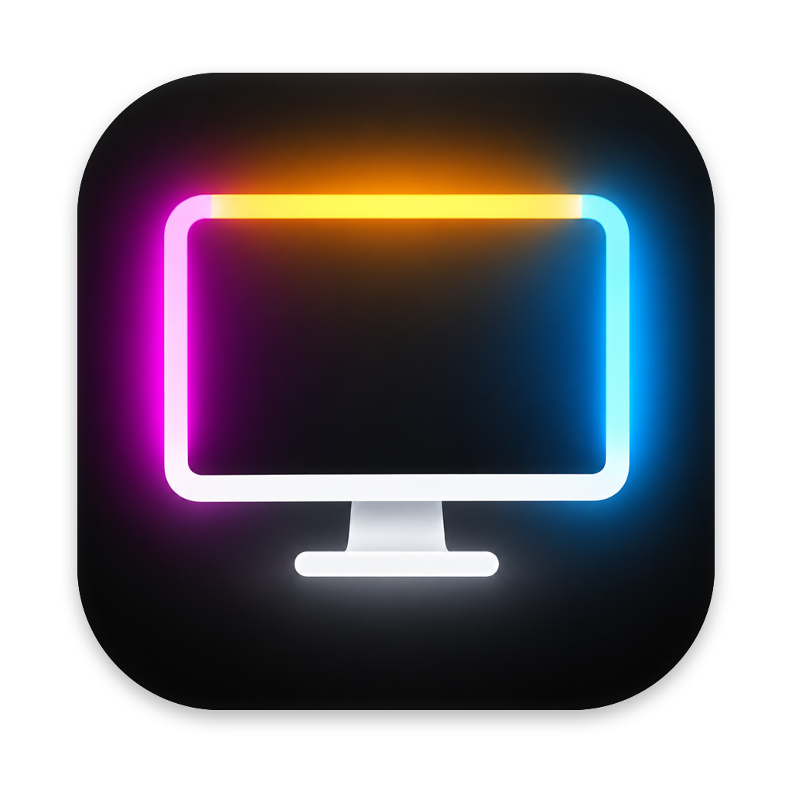
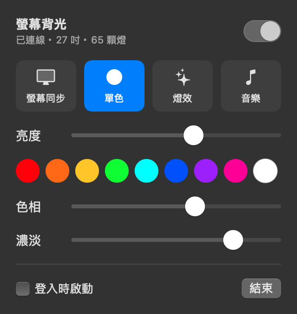
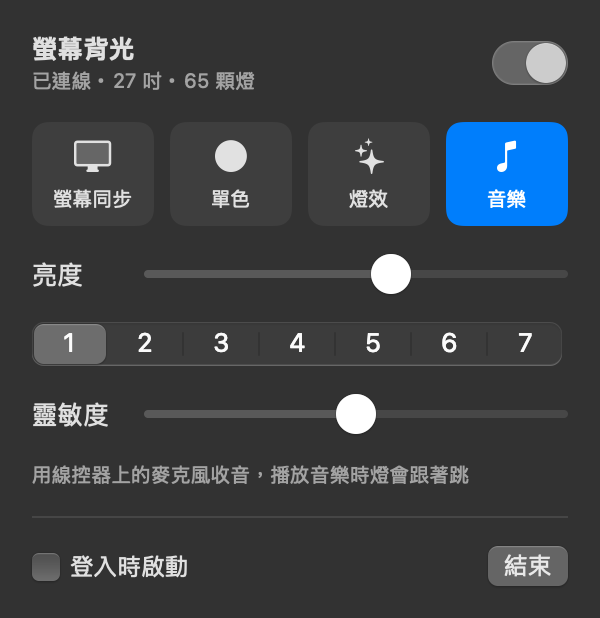

<p align="center">
  
</p>

<h1 align="center">螢幕背光 MonitorGlow</h1>

<p align="center">
  控制 ROBOBLOQ SyncLight USB 螢幕燈條的 macOS 原生選單列小工具。
</p>

<p align="center">
  <a href="README.md">English</a> · <b>繁體中文</b>
</p>

<p align="center">
  
  
</p>

> **非官方專案。** MonitorGlow 為獨立開發，與 ROBOBLOQ 沒有任何關係，也未獲其認可或支援。文中的「SyncLight」「ROBOBLOQ」僅用來說明相容的硬體。

## 功能

- **螢幕同步**：燈條跟著主螢幕左、上、右三邊的顏色走。可調反應快慢與鮮豔度，會略過影片黑邊。
- **單色**：預設色票，加上色相與濃淡滑桿。
- **內建燈效**：燈條自己的 7 種動態效果，可調速度。
- **音樂**：燈條自己的 7 種聲控模式，用線控器上的麥克風收音。
- **省資源**：在 Mac mini M4 上同步時約 3% CPU、27 MB 記憶體（單次短時間量測）；畫面靜止時不送資料。
- **離線**：程式裡沒有任何連網功能。畫面縮小後只在記憶體裡算平均色，不會存檔。

## 我的燈條能用嗎？

這類燈條常以無品牌或賣家自有名稱販售，盒子上的名字不一定查得到。符合以下兩點就很可能相容：

- 說明書要你到 **quiklight.robobloq.com** 或 **quiklight.robobloq.cn** 下載 **SyncLight（神光同步）**；
- 用 USB 連接電腦，且 ID 與下表相同。

作者這條的說明書寫的產品系列是「Wonderful Life」，USB 製造商字串是 **ROBOBLOQ**。

## 相容性

| | 狀態 |
|---|---|
| USB `1a86:fe07`、型號 `000501`、27 吋、65 顆燈、韌體 1.9.4 | 已實機測試 |
| 其他 USB ID 為 `1a86:fe07` 的燈條 | 應可連線，未測試 |
| `1a86:fe0c`（序列埠版）、藍牙或 Dongle 機種 | 不支援 |

在「系統資訊 → USB」查看：廠商 ID `0x1a86`、產品 ID `0xfe07`、製造商 ROBOBLOQ。

需要 macOS 14 以上。只在 macOS 27、Apple silicon 上開發與測試過。

## 安裝

沒有提供編譯好的版本，請自行編譯。只需要 Xcode Command Line Tools（Swift 6 以上），不用裝 Xcode。

```bash
xcode-select --install          # 已安裝可略過
git clone https://github.com/zx4032410/MonitorGlow.git
cd MonitorGlow
scripts/install.sh
```

`install.sh` 會編譯、取代 `/Applications/螢幕背光.app` 的舊版並開啟。

1. **先結束官方 SyncLight**，並關掉它的開機啟動。SyncLight 執行中時，MonitorGlow 不會連線。
2. 點選單列的燈條圖示。
3. 要用螢幕同步，請到「系統設定 → 隱私權與安全性 → 螢幕與系統音訊錄製」允許本 App，再重新開啟。

左右相反的話，在螢幕同步面板勾選「左右對調」。

### 重新編譯後保留權限

預設使用 ad-hoc 簽章，每次重新編譯後 macOS 可能會要求重新授權螢幕錄製。想避免的話，改用鑰匙圈裡的憑證簽章：

```bash
echo 'CODESIGN_IDENTITY="你的憑證名稱"' > scripts/local.env
```

`scripts/local.env` 不會進 git。

## 安全

- 只能送出固定清單內的指令（見 [`LampCommand.swift`](Sources/GlowCore/LampCommand.swift)）。會改寫燈條身分或燈數的指令刻意不納入。
- 每顆燈的 R+G+B 總和上限為 255，限制 USB 耗電，與官方 App 的預設相同。
- 使用風險請自行承擔，免責聲明見[授權條款](LICENSE)。

## 已知限制

- 只支援主螢幕；非 16:9 螢幕的配置是推算的，未測試。
- 有 DRM 保護的影片（Netflix、Disney+ 等）可能只擷取到黑畫面。
- 睡眠喚醒、USB 拔插重連、登入時啟動已實作，但尚未充分測試。
- App 不處理線控器按鍵。

## 開發

```bash
scripts/test.sh                 # 單元測試
swift run glow                  # 實機除錯工具，先結束 MonitorGlow 與 SyncLight
scripts/make-icon.sh            # 重新產生 App 圖示
```

| Target | 用途 |
|---|---|
| `GlowCore` | 封包、邊緣取色、平滑，不碰硬體 |
| `GlowHID` | USB HID 連線 |
| `MonitorGlow` | 選單列 App |
| `glow` | 命令列除錯工具 |

協定筆記在 [docs/PROTOCOL.md](docs/PROTOCOL.md)。回報其他型號的問題時，請附上 `swift run glow info` 的輸出。請不要在實機上試探未知指令。

## 致謝

- crisnar 的 [openLightsSync](https://github.com/crisnar/openLightsSync)（同系列燈條的 Linux 控制程式）是本專案的協定參考之一。它採 CC BY-NC-SA 4.0 授權，本專案沒有包含其程式碼。
- [OpenRGB](https://openrgb.org/) 也有這個 USB ID 的控制器。想用一套軟體管理多種 RGB 裝置，可以看看它。本專案沒有包含其程式碼。
- 其餘協定細節來自對官方 App 的互通性分析，以及在作者自己的燈條上測試。本專案不含官方 App 的程式碼或素材。
- 開發過程使用 Claude Code 協助；App 圖示由 OpenAI 圖像模型生成。

## 授權

[MIT](LICENSE)
